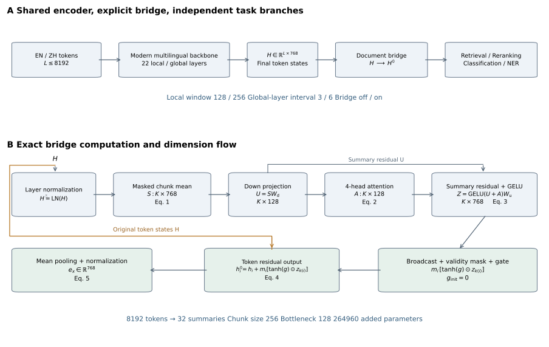

<div align="center">


**面向中英文长文档理解的可复现编码器实验**

[复现流程](#复现流程) · [结构设计](#结构设计) · [开发集结果](#开发集结果) · [文件导航](#文件导航)


</div>

本项目基于固定版本的 mmBERT-base，研究局部注意力、全局交互频率与文档级残差桥接如何共同影响长文档表示。实验覆盖中英文检索、重排、分类和实体识别，提供完整的八组结构配置、数据准备流程、训练评测程序与精简开发集结果。

研究围绕三个相互衔接的环节展开。现代多语言主干形成词元上下文，低维块摘要交互补充文档级信息，零初始化门控将补充内容回写到原始词元表示。共同MLM适配之后，四类任务分别从同一结构检查点训练，便于比较任务相关的结构响应。

## 结构设计



文档桥接在主干末层之后按每256个词元形成掩码块摘要，将768维表示降至128维，通过四头注意力组织跨块交互，再升维并以逐维门控回写。8192词元对应32个摘要，模块新增264960个参数。零初始化使固定主干布局下的桥接初始前向保持恒等，同块词元共享补充而保留原有相对差异。

| 设计维度 | 比较设置 |
| --- | --- |
| 多语言主干 | mmBERT-base，22层，768维 |
| 最大上下文 | 8192词元 |
| 局部窗口 | 128与256 |
| 全局层间隔 | 3与6 |
| 文档桥接 | 关闭与开启 |
| 低秩适配 | LoRA秩8，缩放16 |
| 任务接口 | 双编码检索、交叉编码重排、句对分类、词元实体识别 |

主矩阵为完整的三因素二水平设计。配置名中的 `w` 表示局部窗口，`g` 表示全局层间隔，`b` 表示桥接开关。`w128_g6_local` 额外提供参数匹配的局部摘要控制实现，不属于已报告的八组运行结果。

## 开发集结果

以下结果来自相同模型版本、数据划分和种子42。检索与重排使用 nDCG@10，分类使用准确率，实体识别使用实体级微平均 F1。平均增益为八项质量指标相对 `w128_g3_b0` 的绝对差等权均值。

| 配置 | 检索 EN | 检索 ZH | 重排 EN | 重排 ZH | 分类 EN | 分类 ZH | 实体 EN | 实体 ZH | 平均增益 |
| --- | --- | --- | --- | --- | --- | --- | --- | --- | --- |
| w128_g3_b0 | 0.1656 | 0.1147 | 0.4113 | 0.3828 | 0.4000 | 0.4750 | 0.2132 | 0.0455 | +0.0000 |
| w128_g3_b1 | 0.4189 | 0.2931 | 0.4225 | 0.4253 | 0.4250 | 0.4250 | 0.3014 | 0.1088 | +0.0765 |
| w128_g6_b0 | 0.4418 | 0.2356 | 0.3598 | 0.4082 | 0.3500 | 0.4750 | 0.2893 | 0.0606 | +0.0515 |
| w128_g6_b1 | 0.5126 | 0.3843 | 0.4452 | 0.3855 | 0.4500 | 0.4500 | 0.3429 | 0.1538 | +0.1145 |
| w256_g3_b0 | 0.3516 | 0.2376 | 0.3996 | 0.3800 | 0.3750 | 0.4750 | 0.2346 | 0.0513 | +0.0371 |
| w256_g3_b1 | 0.0398 | 0.0751 | 0.4354 | 0.4177 | 0.3750 | 0.4000 | 0.2838 | 0.0946 | -0.0108 |
| w256_g6_b0 | 0.4858 | 0.3599 | 0.4496 | 0.2959 | 0.3250 | 0.4750 | 0.2989 | 0.1351 | +0.0771 |
| w256_g6_b1 | 0.5019 | 0.3283 | 0.4027 | 0.4222 | 0.4000 | 0.4250 | 0.3172 | 0.0933 | +0.0853 |

`w128_g6_b1` 具有最高平均增益，双语检索分别达到0.5126与0.3843。完整联合筛选同时约束单项任务、冻结表示保留、证据响应与成本，当前八组均未满足全部条件，因此记录的 `selected` 为 `null`。最高均值候选与通过联合筛选的模型具有不同含义，公开结果保留原有判定。

每种语言的主要任务开发集包含40条查询或序列，检索候选池为320篇固定文档，重排使用固定BM25前十候选。这些是受控开发子集上的结果，指标可通过 [CSV](results/dev_metrics.csv) 和 [筛选摘要](results/selection_summary.json) 直接检查。

## 复现流程

### 1 准备环境

正式训练使用 Linux、Python 3.11或3.12，以及已安装 CUDA 版 PyTorch 2.6 的 GPU 环境。下载程序使用curl，主机需提供该命令。本轮运行设备报告显存约22 GiB，全部训练与评估账本累计约19.57小时。请根据设备预留训练与评估时间，并为模型和数据缓存预留充足磁盘。

```bash
git clone https://github.com/rain-xhy/bilingual-nextbert-repro.git
cd bilingual-nextbert-repro
bash scripts/setup_server.sh
source .venv/bin/activate
export HF_HOME="$PWD/.cache/huggingface"
python scripts/verify_release.py
```

`requirements.txt` 固定主要Python依赖，PyTorch需预先按主机CUDA环境安装。无需GPU的离线检查可以在安装CPU版PyTorch后运行 `python -m unittest discover -s tests -v`。完整的微型随机模型集成检查为 `python -m scripts.smoke_architecture`，用于验证流程与8192词元反向传播，不代表真实任务质量。

### 2 下载与固定数据

```bash
python -m scripts.prepare_mldr --train-per-language 2000 --revision d67138e705d963e346253a80e59676ddb418810a
python -m scripts.prepare_multitask
python -m scripts.prepare_evidence
python -m scripts.audit_evidence
python -m scripts.verify_prepared_data
```

数据从公开上游获取，仓库保存版本与派生文件摘要。MLDR在划分前检查训练材料与评估文档的重合，辅助数据由 `artifacts/dataset_lock.json` 固定版本。重新生成的数据应先通过SHA256核验，再进入训练。下载默认使用官方端点，网络需要时可显式设置 `HF_ENDPOINT=https://hf-mirror.com`。各上游数据集与模型的使用条件遵循其原始说明。

### 3 容量检查与八组训练

```bash
python -m scripts.budget_run -- python -m scripts.run_architecture --phase capacity
python -m scripts.budget_run -- python -m scripts.run_architecture --phase train
```

每组运行60步MLM、80步检索、60步重排、100步分类和100步实体识别，总计400次更新。八组合计3200次更新。MLM实际使用60条精确8192词元输入，四个监督分支独立继承共同MLM检查点。24小时预算账本约束训练与评估总消耗，运行中不要修改固定的数据划分、步数和结构协议。

### 4 开发集评测与结果导出

```bash
python -m scripts.budget_run -- python -m scripts.run_architecture --phase evaluate --split dev
python -m scripts.select_architecture
python -m scripts.summarize_results
```

评测覆盖四类任务、双语冻结探针与六视图证据诊断。训练阶段、数据摘要和评估协议经一致性核验后进入筛选。选择器在没有合格模型时保留空结果，测试集访问要求先冻结合格的开发集选择。重复实验请使用新的输出目录，保留已有结果。

## 文件导航

```text
src/                    编码器、桥接、训练目标、任务评测与梯度缓存
configs/architecture/   八组主配置、局部控制与固定实验计划
scripts/                数据准备、训练编排、筛选与复现核验
tests/                  结构、指标、掩码和预算测试
artifacts/              基础模型与辅助数据版本锁
repro/manifests/        派生数据文件摘要
repro/release_manifest.json  发布文件校验与来源说明
results/                精简开发集得分与联合筛选摘要
assets/                 方法示意与README视觉资源
```

## 复现记录

模型固定为 `jhu-clsp/mmBERT-base` 的 `c5955035435e2bf121cde7f3c8863ef52ff35d82`。主体实现来自已完成实验的源码快照，发布调整仅涉及MLDR版本参数、默认下载端点与独立核验工具，详见发布清单。原始数据和训练权重在复现时由数据准备与训练流程生成。

完整训练和评估依赖GPU及上游数据下载。离线测试验证实现与协议，数据摘要验证样本构造，开发集CSV提供可比较的结果参照。不同设备的浮点执行可能产生数值差异，建议同时检查数据摘要、训练暴露、配置和指标趋势。

本发布已通过20项离线单元测试，以及微型随机模型的端到端结构集成检查。后者覆盖基线与桥接的8192词元MLM反向传播、四类监督任务、冻结探针、证据诊断、联合筛选和结构检查点重载。GitHub Actions在推送后自动执行发布校验和单元测试。

## 研究基础

本实现复用现代多语言编码器与通用参数高效适配方法，并在其上研究文档级残差桥接及完整结构组合。基础模型和相关方法的来源如下。

- [ModernBERT](https://aclanthology.org/2025.acl-long.127/)
- [mmBERT](https://huggingface.co/jhu-clsp/mmBERT-base)
- [LoRA](https://arxiv.org/abs/2106.09685)
- [Gradient Cache](https://aclanthology.org/2021.repl4nlp-1.31/)
- [MLDR](https://huggingface.co/datasets/Shitao/MLDR)

